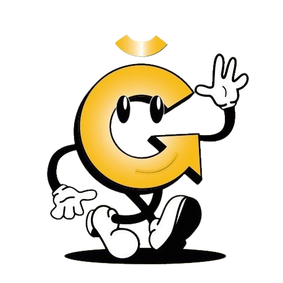
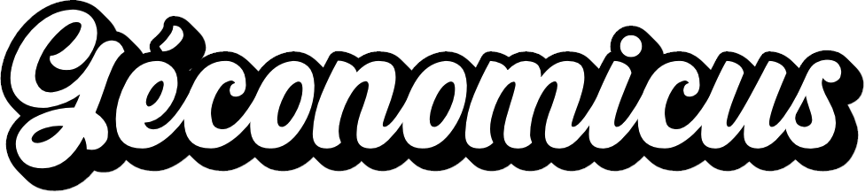
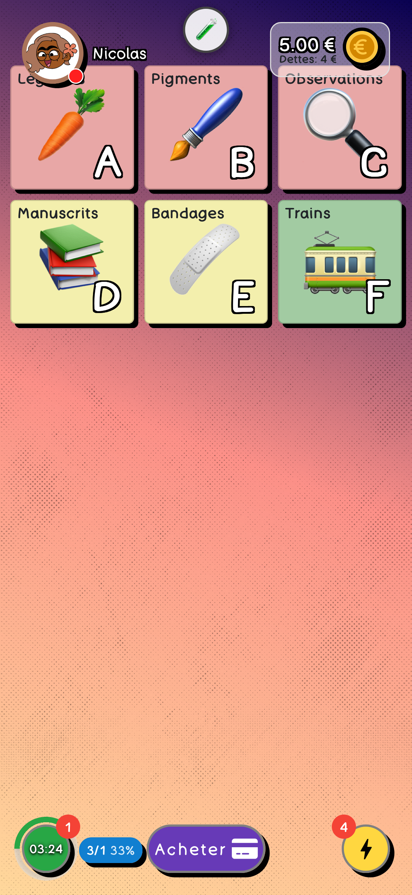

#  

play game geconomicus

to launch it (in dev env)
start your mongodb service first
- cd /to/your/db/folder
- mongod --dbpath .
- mongod

start backend api
- npm install
- npm run start

start front
- npm install
- npm run start

player view :

## 📜 License
This project is available under a dual-license model:
- ✅ Free for open-source and non-commercial use under [AGPL v3](./LICENSE).
- 💰 Commercial use requires a [separate license](./COMMERCIAL-LICENSE.txt).

Contact: contact@geconomicus.fr

Deroulement:
DEBUT
1. L'animateur crée une session et choisit le theme
2. Les joueurs se connectent
3. Les joueurs choisissent leur nom, puis choisissent leur avatar
4. L'animateur demarre la session
5. l'animateur choisit la premiere monnaie (june ou dette) et lance la partie
6. les joueurs sont notifiés et rejoignent la partie qui vient d'être lancée
7. l'animateur distribue les cartes et demarre la manche
8. les joueurs jouent
9. la manche se termine apres 20 minutes
10. l'animateur redirige les joueurs vers le questionnaire et retourne sur la salle d'accueil
11. l'animateur choisit la seconde monnaie (restante june ou dette) et lance la partie
12. les joueurs sont notifiés et rejoignent la partie qui vient d'être lancée
13. l'animateur distribue les cartes et demarre la manche
14. les joueurs jouent
15. la manche se termine apres 20 minutes
16. l'animateur redirige les joueurs vers le questionnaire et retourne sur la salle d'accueil
17. l'animateur termine la session et genere les resultats
18. les joueurs sont notifiés et peuvent se rediriger vers les resultats
FIN
